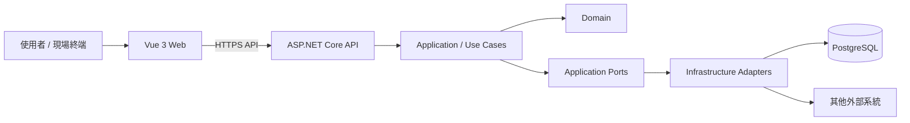

# 共用系統架構基底

## 1. 預設技術

- 後端：所有專案預設使用 .NET / ASP.NET Core；各專案採用當時仍受支援的版本並固定版本號。
- 前端：Vue 3 + TypeScript；Web 預設為桌面與行動裝置自適應版面，使用 Vite 建置。
- Web 與 API 分別建置、設定和部署。Web 以 HTTPS 呼叫 API，不直接連資料庫，也不含伺服器祕密。
- PostgreSQL 為預設資料庫。PostgreSQL 軟體可免費商用；主機、代管、支援與維運可能收費。散佈 PostgreSQL 本體時保留授權與著作權聲明。
- 客戶需要其他資料庫或服務時，於專案規格記錄決策與相容性範圍。

## 2. 系統邊界與依賴方向

依賴方向朝向 Domain 與 Application。Web、HTTP、資料庫驅動和作業系統細節不得滲入 Domain。

## 3. DDD + Clean Architecture 職責

- **Domain**：Entity、Value Object、Domain Policy 與純業務規則；不做 IO。
- **Application**：Use Case、應用協調、輸入輸出契約及所需 Ports。
- **Infrastructure**：Repository、資料庫、外部 API、檔案等 Ports 的實作。
- **API**：HTTP、伺服器端認證授權、輸入輸出與 API 層日誌；呼叫 Application。
- **Web**：畫面、互動、表單狀態和 API 呼叫；不複製伺服器端權限判斷或核心業務規則。

資料庫專屬 SQL、型別與驅動程式留在 Infrastructure。PostgreSQL 為預設；替換 Provider 時評估 SQL、型別、Migration、交易與效能差異。

## 4. 測試和交付

- Unit Test 使用 Fake/Mock，不連正式資料庫或正式外部系統。
- Integration Test 與 Unit Test 分開，僅連接明確指定的測試環境。
- 會寫入真實資料、寄信或呼叫設備的測試需 opt-in。
- Release 前驗證 API 健康檢查、前端/API 契約、Migration 與部署設定。
- Migration 要有版本、執行順序、備份前置條件及回復/向前修正策略。

各 API 的命名、路由、回應和更細的分層規則依專案 API 規範執行。

## 5. 例外

YMES 登入、主選單及所有主檔清單、表單與關聯編輯器均使用 Vue 3；Web 只透過 /YMES/API 呼叫 ASP.NET Core API。MVC 專案是遷移前原型，不納入目前 Web 部署；Web 與 API 分別建置和部署在 /YMES 路徑下。

例外記錄差異、理由、風險、補償控制、核准人及檢視日期。共用基底提供安全且可維護的預設，不以形式流程阻止正常開發。
